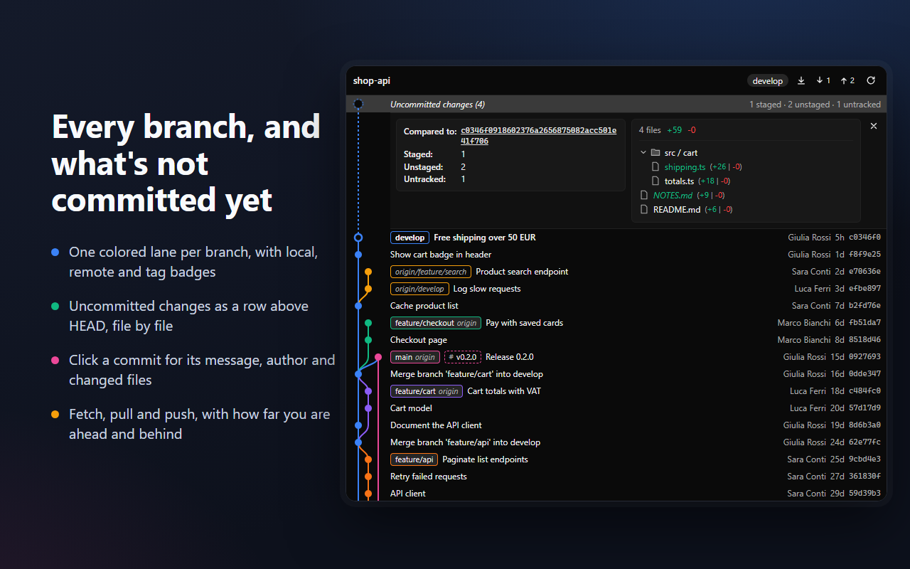
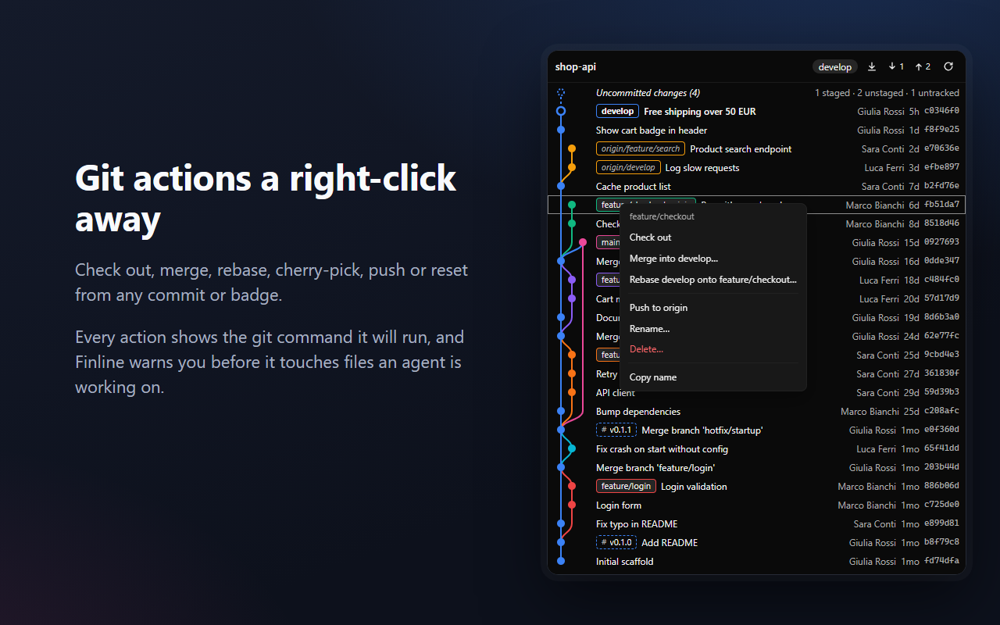

<p align="center">
  
</p>

<h1 align="center">Finline</h1>

<p align="center">
  A git graph for <a href="https://onorca.dev">Orca</a>: the commits of the focused worktree in
  colored lanes, with branches, tags and remotes, in Orca's right sidebar.
</p>

<p align="center"><em>fin</em> (an orca's fin) + <em>line</em> (the lanes of the graph).</p>





## Features

- Commit graph drawn in SVG: one lane per branch, merges and forks as curves, HEAD as a hollow node.
- Ref badges: local branches together with their remote copy (`main · origin`), remote-only
  branches in italics, tags with a dashed border.
- Follows the focused Orca workspace and refreshes by itself when HEAD, branches, tags or the
  index change, from Orca, a terminal or an agent.
- Loads 200 commits at a time as you scroll.
- Click a commit to open its details under it: hash, parents, author and committer, the full
  message, and the changed files as a folder tree with line counts.
- Fits the narrow sidebar: author and hash columns appear only when there is room.
- Git actions from a right-click on a commit or a badge (or Shift+F10, or the ⋯ in the details):
  - branches and tags: check out, create, rename, delete, push, delete from the remote;
  - integration: merge, rebase, cherry-pick, revert, and a banner to continue or abort a stopped
    one;
  - reset (soft, mixed, hard) and copying a hash or name.
- Fetch, pull and push in the header, with how far the branch is ahead and behind.
- Every action shows the git command it will run. Finline warns before changing files that have
  uncommitted changes or that an agent is working on, and asks before anything destructive.

Diffs are planned.

## Install

In Orca, open **Settings → Plugins**, search for **Finline** and install it. Then open the
**Finline** tab in the right sidebar.

Requires Orca 1.4.248 or later and `git` on your `PATH`.

## Access it asks for

Finline is a **full-access** plugin (`trusted-worker`): Orca asks you to approve it on install.

- **Runs a worker process** that calls your system `git` in the focused workspace's folder and
  watches that repository's `.git` folder for changes. It reads on its own; it changes the
  repository only when you pick an action, with fixed git arguments it validates first.
- **`workspace:read`**: reads the focused workspace's name and branch, and the list of workspaces,
  to find which repository to show.
- **`agent:read`**: sees whether an agent is working in the workspace, to warn you before an
  action changes its files.
- **`terminal:send`**: when a fetch, pull or push needs credentials git cannot ask for in the
  background, "Run in terminal" opens a new Orca terminal with that git command.

Finline itself makes no network requests and collects no data. Fetch, pull and push reach your
remotes through git, with your git credentials.

## Known limitations

- Orca does not yet tell plugins the focused workspace's folder, so Finline matches it by name and
  branch. When two workspaces share both (for example two worktrees on `develop`), Finline asks you
  once which repository it is.
- Workspaces on remote (SSH) hosts are experimental and work on macOS only. Finline runs git there
  over `ssh` with your SSH config and keys, and checks for changes every 3 seconds, so a fetch or a
  new tag shows up on the next refresh rather than right away.

## Development

```sh
orca plugin dev watch .                # load this folder into Orca and stream its logs
node --test src/*.test.ts              # layout and git parser tests (Node >= 22.18)
orca plugin validate .                 # the catalog's manifest checks
```

- `src/worker.ts` (worker): resolves the repository, runs `git`, watches `.git`.
- `src/layout.ts`: assigns lanes and routes edges; pure, with tests.
- `src/graph/` (html panel): draws the graph and the commit list.

To try the panel on another repository, put its path in `.orca/dev-repo.txt` (git-ignored). The
worker then shows that repository instead of the focused workspace.

Notes from the first prototype are in [docs/prototype-findings.md](docs/prototype-findings.md).

## License

[MIT](LICENSE) © 2026 Denni Bevilacqua
